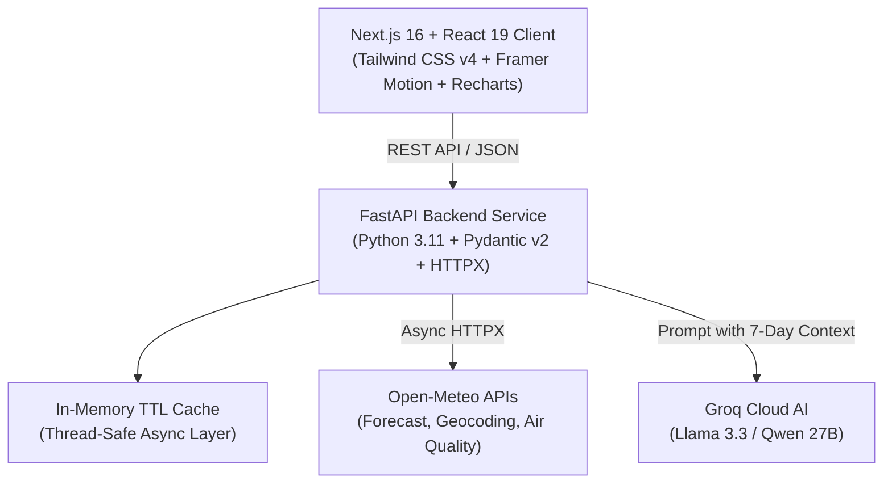

<p align="center">
  
</p>

<h1 align="center">Atmos — Hyperlocal Weather Intelligence & Glassmorphic Dashboard</h1>

<p align="center">
  <strong>Production-grade, atmospheric glassmorphism weather intelligence dashboard powered by Open-Meteo, Next.js 16, FastAPI, and Groq AI.</strong>
</p>

<p align="center">
  
  
  
  
  
  
  
</p>

---

## Overview

**Atmos** is a full-stack, production-grade weather web application designed with a dark/light atmospheric glassmorphism aesthetic. It integrates real meteorological models from **Open-Meteo**, including hyperlocal forecast observations, 24-hour temperature trends, an expandable 7-day outlook, European Air Quality Index (AQI) indicators, and a grounded AI smart weather assistant powered by **Groq** (`qwen/qwen3.8-27b` / Llama 3.3).

---

## Key Features

1. **Hyperlocal Weather Hero**
   - Live temperature, feels-like metric, atmospheric conditions, and daily high/low temperatures.
   - Micro-metrics for relative humidity, wind speed, horizontal visibility, and atmospheric pressure.
   - Dynamic, weather-reactive ambient animated backgrounds that respond to weather categories (`clear`, `cloudy`, `rain`, `storm`, `snow`) and day/night cycles.

2. **24-Hour Hourly Forecast & Temperature Trend**
   - Horizontally scrollable 24-hour forecast strip with real-time precipitation probabilities and conditions.
   - Interactive SVG area trend chart powered by Recharts with custom tooltip formatting.

3. **7-Day Atmospheric Outlook**
   - Day-by-day forecast cards featuring conditions, precipitation probabilities, and temperature ranges.
   - Expandable daily details revealing solar cycle (sunrise / sunset), max UV index, max wind speed, and precipitation sum.

4. **Detailed Weather Metrics & European AQI Scale**
   - Visual European Air Quality Index badge with color categorization (`Good`, `Fair`, `Moderate`, `Poor`, `Very Poor`).
   - Detailed particulate breakdown: PM2.5, PM10, Nitrogen Dioxide ($\text{NO}_2$), and Ozone ($\text{O}_3$).

5. **Smart Weather Assistant**
   - AI assistant grounded strictly in verified real forecast and air-quality data up to the full 7-day outlook.
   - Answers questions regarding rain chances, umbrella necessity, outdoor suitability, evening temperatures, multi-day comparisons, and specific days (e.g. *"weather after 2 days"*, *"7-day outlook"*, *"weekend forecast"*).
   - Powered by **Groq** with intelligent rule-based fallback capability.
   - Dedicated bot avatar icon (`/bot.png`).

6. **Instant City Search & Geocoding**
   - Debounced search querying Open-Meteo's Geocoding API with timezone and country details.
   - Direct GPS current location retrieval with browser geolocation API fallback.

7. **Sleek Custom Glassmorphic Scrollbar & Brand Favicon**
   - Custom 8px glowing glassmorphic scrollbar with smooth theme transitions.
   - Custom brand tab icon automatically synchronized across browser tabs.

---

## System Architecture



---

## Tech Stack

| Domain | Technologies |
| :--- | :--- |
| **Frontend** | Next.js 16 (App Router), React 19, TypeScript, Tailwind CSS v4, Framer Motion, Recharts, Lucide React |
| **Backend** | Python 3.11+, FastAPI, Pydantic v2, Pydantic-Settings, HTTPX, Pytest, Uvicorn |
| **AI / LLM** | Groq Cloud API (`qwen/qwen3.8-27b` / Llama 3.3) with grounded context & rule-based fallback |
| **Data Provider** | Open-Meteo Forecast, Geocoding, and Air Quality APIs (Free non-commercial tier) |
| **DevOps** | Vercel (Frontend), Railway / Render (Backend), Docker Compose, Multi-stage Dockerfiles |

---

## Project Structure

```
Atmos/
├── backend/
│   ├── app/
│   │   ├── api/routes.py          # REST endpoints
│   │   ├── core/config.py         # Environment settings
│   │   ├── schemas/weather.py     # Pydantic data schemas
│   │   ├── services/
│   │   │   ├── air_quality.py     # AQI processing
│   │   │   ├── assistant.py       # Groq & rule-based assistant
│   │   │   ├── cache.py           # Thread-safe in-memory cache
│   │   │   ├── geocoding.py       # Location search
│   │   │   └── weather.py         # Forecast processing
│   │   └── main.py                # FastAPI app & CORS
│   ├── tests/
│   │   └── test_weather.py        # Automated test suite
│   ├── .env.example
│   ├── Dockerfile
│   ├── requirements.txt
│   └── README.md
├── frontend/
│   ├── public/
│   │   ├── bot.png                # Assistant avatar
│   │   ├── favicon.ico            # Browser favicon
│   │   ├── icon.png               # App icon
│   │   └── logo.png               # Brand logo
│   ├── src/
│   │   ├── app/
│   │   │   ├── globals.css        # Tailwind v4, glassmorphism & custom scrollbar
│   │   │   ├── layout.tsx         # Metadata & tab icons
│   │   │   └── page.tsx           # Main application view
│   │   ├── components/            # React components
│   │   ├── services/api.ts        # Backend API client
│   │   ├── types/weather.ts       # TypeScript definitions
│   │   └── utils/formatters.ts    # Date & temperature helpers
│   ├── .env.example
│   ├── Dockerfile
│   ├── package.json
│   └── README.md
├── docker-compose.yml             # Full-stack container orchestration
├── .gitignore                     # Git ignore rules
├── LICENSE                        # MIT License
├── logo.png                       # Repository banner asset
└── README.md                      # Main project documentation
```

---

## Getting Started Locally

### Prerequisites
- **Python 3.11+**
- **Node.js 18.18+ or 20+** & **npm**

---

### 1. Backend Setup

```bash
cd backend

# Create virtual environment (optional but recommended)
python -m venv venv

# Activate virtual environment:
# Windows:
.\venv\Scripts\activate
# Linux/macOS:
# source venv/bin/activate

# Install dependencies
pip install -r requirements.txt

# Create .env from template
cp .env.example .env

# Start FastAPI server
python -m uvicorn app.main:app --host 127.0.0.1 --port 8000 --reload
```

Backend will be accessible at:
- API Root: `http://localhost:8000`
- Interactive Swagger Docs: `http://localhost:8000/docs`
- Health Check: `http://localhost:8000/api/health`

---

### 2. Frontend Setup

In a new terminal window:

```bash
cd frontend

# Install dependencies
npm install

# Create .env from template
cp .env.example .env

# Start development server
npm run dev
```

Open [http://localhost:3000](http://localhost:3000) in your browser.

---

## Running Automated Tests

Run backend unit tests for weather code interpretation, caching TTLs, 7-day outlook queries, and grounded assistant responses:

```bash
python -m pytest backend/tests/ -o pythonpath=backend
```

Run frontend production build verification:

```bash
npm --prefix frontend run build
```

---

## How to Deploy on Vercel (Step-by-Step)

Deploying Atmos to **Vercel** is seamless. Follow these steps:

### Step 1: Deploy Your Backend First
Because Vercel specializes in frontend and serverless functions, deploy your FastAPI backend to a service like **Railway**, **Render**, or **Fly.io**:

1. **Deploy to Railway / Render**:
   - Create a project on [Railway](https://railway.app/) or [Render](https://render.com/).
   - Set the root directory to `backend`.
   - Start command: `uvicorn app.main:app --host 0.0.0.0 --port $PORT`.
   - Add environment variables (`GROQ_API_KEY`, etc.).
   - Note your live backend URL (e.g., `https://atmos-api.up.railway.app`).

---

### Step 2: Deploy Frontend on Vercel

1. Push your repository to **GitHub**:
   ```bash
   git add .
   git commit -m "feat: ready for deployment"
   git push origin main
   ```

2. Sign in to [Vercel](https://vercel.com/) and click **"Add New..."** → **"Project"**.
3. Select your GitHub repository and click **"Import"**.
4. In the **"Configure Project"** screen:
   - **Root Directory**: Click **"Edit"** and select `frontend`.
   - **Framework Preset**: Next.js (automatically detected).
   - **Build Command**: `next build` (default).
   - **Output Directory**: `.next` (default).
5. Open the **"Environment Variables"** section and add:

   | Name | Value |
   | :--- | :--- |
   | `NEXT_PUBLIC_API_URL` | `https://atmos-api.up.railway.app` *(your backend URL)* |

6. Click **"Deploy"**.

---

### Step 3: Add Vercel Domain to Backend CORS
In your backend environment variables on Railway/Render, add your Vercel deployment domain to `CORS_ORIGINS`:

```ini
CORS_ORIGINS=["https://your-atmos-app.vercel.app","http://localhost:3000"]
```

Your Atmos weather dashboard is now live in production with global CDN acceleration and SSL!

---

## Docker Deployment (Local & VPS)

To build and run both the frontend and backend simultaneously using Docker Compose:

```bash
docker-compose up --build -d
```

- **Frontend**: `http://localhost:3000`
- **Backend API**: `http://localhost:8000`

To stop the containers:
```bash
docker-compose down
```

---

## API Reference

- `GET /api/health` — Health verification
- `GET /api/locations/search?q={query}&count={count}` — Geocoding city search
- `GET /api/weather/forecast?latitude={lat}&longitude={lon}` — Real-time, 24h hourly, and 8-day daily forecast
- `GET /api/air-quality?latitude={lat}&longitude={lon}` — European & US AQI with pollutant details
- `POST /api/assistant/chat` — Contextual AI weather query answering

---

## License & Attribution

- Released under the [MIT License](LICENSE).
- Meteorological and Geocoding data provided by [Open-Meteo](https://open-meteo.com/) under non-commercial CC BY 4.0 terms.
- Built with ❤️ for showcase & portfolio use.
